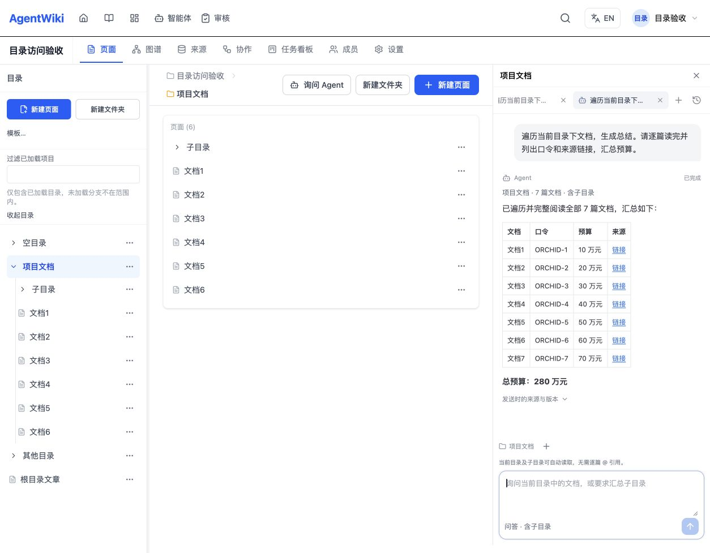

# 内嵌 Agent 目录遍历验收

日期：2026-10-19。分支：`codex/agent-directory-access`。基线：`1a79d4a2ee71dd0f43f618d555edb7171b85040e`（v0.12.51）。本记录是独立工作树中的本地验收，未部署生产。

## 问题与修复

原会话必须指定单篇文章，只向模型提供文章快照和最多 5 个显式引用；OpenCode 同时禁止所有工具调用。因此“遍历当前目录下文档，生成总结”无法访问目录内容。

现在文章内会话自动继承文章所属目录；空间根目录、文件夹也提供“询问 Agent”入口，无需先打开文章或逐篇添加 @ 引用。默认包含子目录。模型通过专用只读 MCP 工具分页列举文档、分段读取正文，并在总结中引用来源。

- 读取范围由服务端根据当前用户的空间权限和目录树确定，客户端不能提供正文快照清单来扩大权限。
- 仅允许读取本轮授权目录快照。已删除、孤立、循环目录，以及其他空间文档不在范围内；每次会话访问和执行检查仍验证实时成员资格及文档当前位置。
- 目录问答不提供页面写入模式；文章原有问答和修改候选流程保留。
- 目录范围分别保存草稿和标签状态，首次进入新目录不会自动打开其他目录的历史任务。
- 历史、轮询、授权检查通过 PostgreSQL JSONB 投影排除目录正文；仅当前任务开始执行时读取完整正文。
- 模型工具输出中的正文不会进入进度流或原始事件日志；专用工具以外的文件系统、命令和网络工具继续拒绝。

## 实际链路验收

在隔离的本地 PostgreSQL、Redis、API、Worker 和 Vite 中建立合成空间。目录含 6 篇直属文章、子目录含第 7 篇，正文分别包含 `ORCHID-1` 至 `ORCHID-7`，预算依次为 10 至 70 万元；另有目录外和根目录文章作为范围对照。

1. **真实模型分页读取**：使用 `bailian-coding-plan/qwen3.7-plus` 和真实 OpenCode，分 3 次列举（cursor 0/3/6），完成 7 次读取，返回全部正文口令及来源链接。见 [runtime-db-probe.json](runtime-db-probe.json)。
2. **真实浏览器 → API → Worker → 模型**：直接在文件夹发送“遍历当前目录下文档，生成总结。请逐篇读完并列出口令和来源链接，汇总预算。”。数据库确认 `pageId=null`、显式引用数为 0、任务完成，结果含全部 7 个口令、7 个链接和正确合计 280 万元。见 [browser-receipt.json](browser-receipt.json) 和下方截图。
3. **真实 API**：递归目录 7 篇、根目录 9 篇、文章自动推导目录 7 篇、仅直属 6 篇、空目录 0 篇均正确；缺失范围、伪造目录、非法范围字段和无文章的修改请求均拒绝。最终服务端构建后重跑 9 项通过，见 [http-receipt.json](http-receipt.json)。
4. **真实 PostgreSQL**：验证 JSONB 投影不加载正文、任务初次执行取得完整正文、公开响应不含目录正文、移出目录后拒绝旧会话、撤销成员资格后拒绝会话，以及非法正文类型不被投影掩盖。6 项通过，见 [db-receipt.json](db-receipt.json)。
5. **浏览器入口**：最终使用生产构建 `index-DzwN9NYg.js`（Vite preview，同一真实 API）重新加载文章、进入目录、打开面板，确认真实 7 篇总结及来源链接仍正确显示，无新增生产运行错误。检查[根目录入口](root-directory-entry.png)与[文章内入口](article-directory-entry.png)，目录问答及文章原有模式均显示正确。

## 回归与审查

- 客户端全量：161 个文件、2712 项通过，见 [client-full-summary.txt](client-full-summary.txt)。
- 服务端全量：177 个套件、3422 项通过；7 个套件、45 项按既有环境条件跳过，见 [server-final-full-summary.txt](server-final-full-summary.txt)。
- 最后客户端局部文案与入口加载收尾后，12 个文件、396 项定向回归通过；清理未使用的旧 `editor.assist` 中英文文案后，i18n 与构建预算 147 项通过。较早的 2712 项全量结果与最终增量结果分别保留。
- 客户端生产构建通过：首屏脚本 **549985 / 550000 字节**；未提高预算或修改 Vite 分块规则。见 [构建回执](client-production-final-summary.txt)。
- 服务端生产构建、类型检查、修改文件 ESLint 通过；最终客户端构建含类型检查，修改文件 ESLint 通过。
- 独立审查覆盖目录授权、树遍历、历史正文投影、运行器输出边界和客户端会话隔离；发现的资源读取及回退边界问题已修复并复查，最终无未解决 P1/P2/P3，可本地提交。

## 明确边界

目录快照上限为 1000 篇、序列化内容 5,000,000 字符，空间目录树上限为 10,000 个文件夹。超过上限会明确报错；文章自动附带目录超过上限时，保留单篇问答和修改能力，并明确说明目录正文未加载。API 支持 `recursive:false` 缩小范围，当前界面默认递归。

本次实际运行环境为 macOS；未以模拟测试代替 Windows 原生验收。超大目录不承诺一次模型调用完成，提示词要求如实说明未读内容。本文及回执仅保存合成数据，不包含登录信息、数据库凭据或模型密钥。
